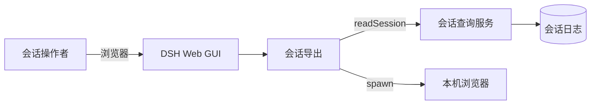
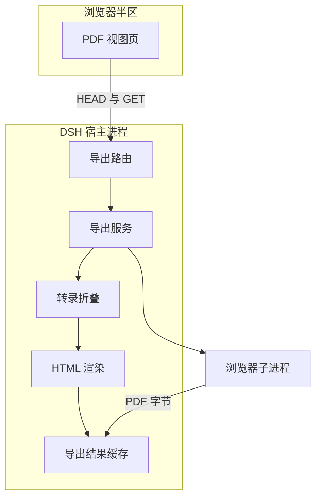
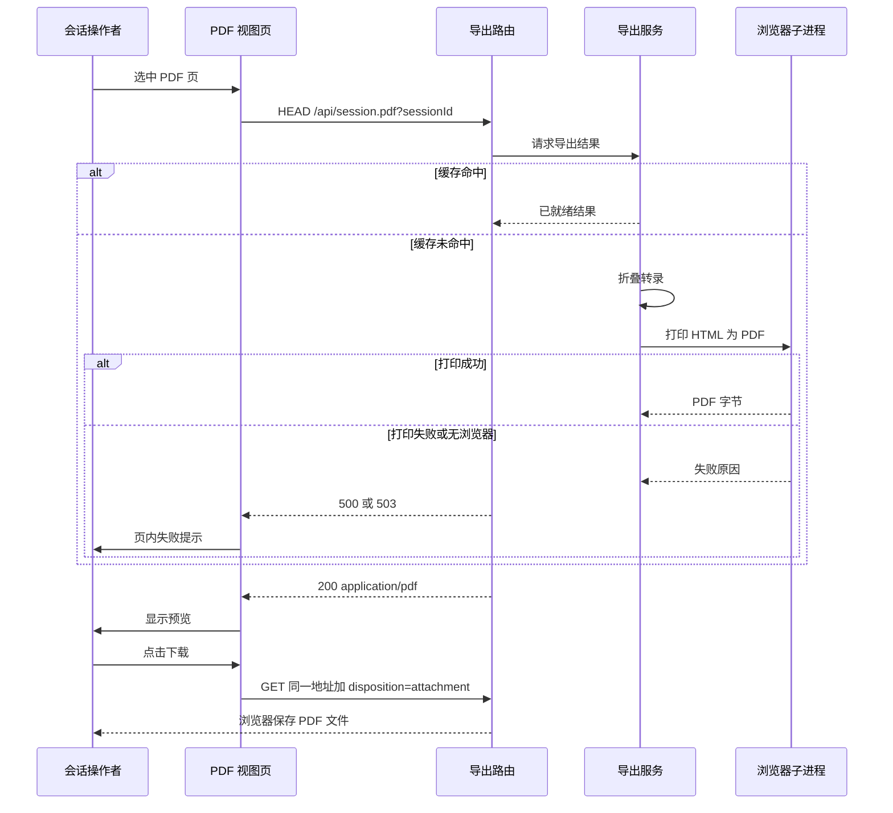
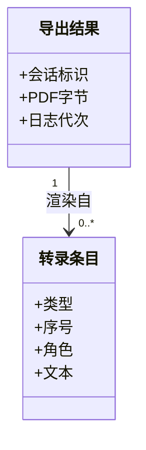
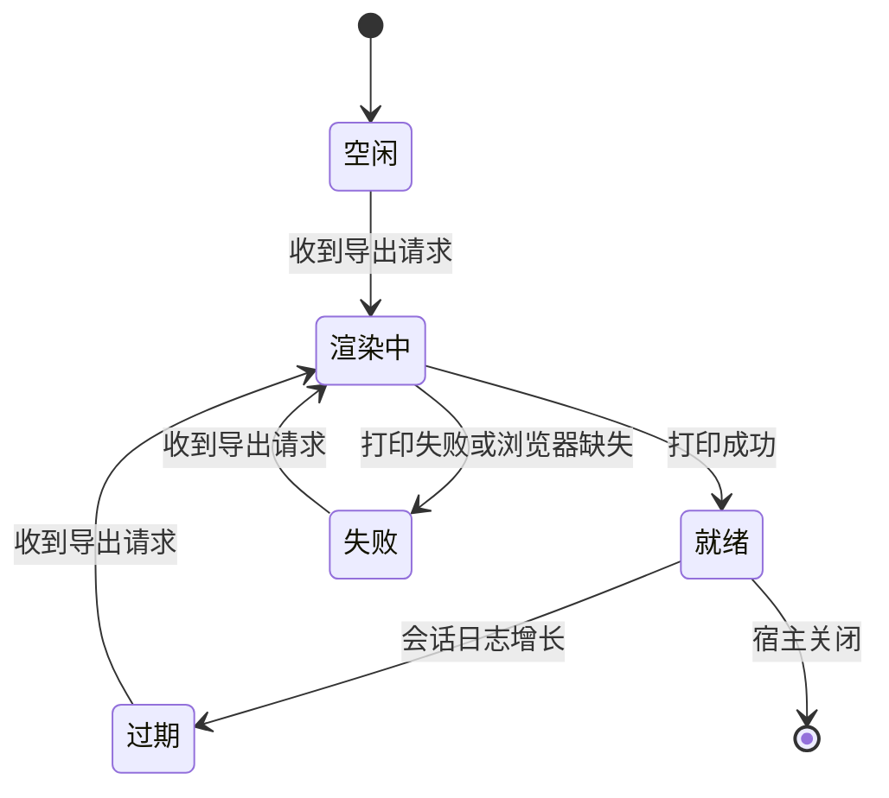

# SOLUTION — 会话导出为 PDF

## 架构视图清单

| 视图 | 适用性/理由 | 图表位置 |
|---|---|---|
| 系统上下文 | 适用：插件位于 DSH 宿主内，外部只有会话日志、会话查询服务与本机浏览器。 | 系统上下文图 |
| 一级静态分解 | 适用：宿主半区与浏览器半区通过一条精确路由相连，是全部实现的骨架。 | 一级静态分解图 |
| 内部组件分解 | 不适用：一级分解已把五个组件展开到可实现的粒度，再拆一层只是重复。 | — |
| 运行时交互 | 适用：首次选中、缓存命中、渲染失败、下载四条路径的行为不同，需要图固定。 | 运行时交互图 |
| 数据与领域模型 | 适用：转录条目是渲染器的唯一输入，其类型结构决定内容正确性。 | 数据与领域模型图 |
| 状态与生命周期 | 适用：导出结果在内存中经历就绪、过期与失败，缓存与复用规则依赖该状态机。 | 状态与生命周期图 |
| 数据流与信任边界 | 适用：会话内容从日志经宿主流向浏览器，下载接口跨越信任边界。 | 数据流与信任边界图 |
| 部署 | 不适用：插件随宿主进程加载，没有独立部署节点与制品。 | — |
| 分层与依赖 | 不适用：两个半区加一条路由已在一级分解中表达，依赖方向单一。 | — |
| 系统景观 | 不适用：只服务单个 DSH 宿主，不与其他产品集成。 | — |

## 方案细化清单

| 关注面 | 适用性/理由 | 方案落点 |
|---|---|---|
| 边界与对外契约 | 适用：路由的路径、参数、状态码与响应头是浏览器半区的唯一依赖。 | SOLUTION.md#产品契约 |
| 核心数据与不变量 | 适用：转录条目的顺序与排除规则决定导出内容是否正确。 | SOLUTION.md#核心数据与不变量 |
| 状态与生命周期 | 适用：缓存命中、过期与失败决定预览与下载是否一致。 | SOLUTION.md#导出状态与生命周期 |
| 运行时、并发与失败语义 | 适用：同一会话并发请求要合并，渲染超时与浏览器缺失要可区分。 | SOLUTION.md#运行时与失败语义 |
| 外部集成 | 适用：会话查询服务与本机浏览器可执行文件是两个外部依赖。 | SOLUTION.md#外部集成 |
| 配置与可变点 | 适用：浏览器路径与超时是仅有的两个可变点。 | SOLUTION.md#配置与可变点 |
| 安全与信任边界 | 适用：下载接口承载会话内容，必须落在宿主的鉴权栅栏内。 | SOLUTION.md#安全与信任边界 |
| 部署、迁移与恢复 | 不适用：插件无独立部署、无持久化数据、无迁移与恢复流程。 | — |
| 兼容性与版本演进 | 适用：页签插槽与路由 API 属于宿主契约，版本边界要声明。 | SOLUTION.md#兼容性与版本演进 |
| 可观测性与运维 | 不适用：没有独立运维面，失败经由页内提示与宿主进程日志暴露。 | — |

## 实现就绪检查

| 条件 | 结论 | 证据或落点 |
|---|---|---|
| 边界与契约已明确 | 通过 | SOLUTION.md#产品契约 |
| 关键不变量已明确 | 通过 | SOLUTION.md#核心数据与不变量 |
| 重大方案选择已收敛 | 通过 | RATIONALE/C-001-chromium-print-html.md |
| 目标实现归属已明确 | 通过 | SOLUTION.md#子系统与模块 |
| 现状差距已有 task 承接 | 通过 | 新仓库无实现，T-001 承接全部需求 |
| 可派生验证 | 通过 | SOLUTION.md#产品契约 |

## 静态架构

### 系统上下文图

会话日志是唯一的导出数据源。会话查询服务负责读取与校验日志，插件不直接触碰磁盘上的日志文件。本机浏览器只负责把 HTML 打印成 PDF，不读取任何会话数据。

### 一级静态分解图

路由只做参数校验与响应构造，不持有渲染逻辑。转录折叠与 HTML 渲染是纯函数，不接触宿主服务，可独立测试。

## 运行时视图

### 运行时交互图

预览与下载使用同一份导出结果，所以下载不会重新渲染。

## 数据视图

### 数据与领域模型图

转录条目的类型只有四种：用户消息、助手回复、工具调用、思考块。思考块在折叠阶段丢弃，不进入 PDF。

### 状态与生命周期图

导出结果只存在于宿主内存，不落盘。会话日志增长使结果过期，下一次请求重新渲染。

## 补充架构视图

### 数据流与信任边界图

信任边界在导出路由上。宿主浏览器鉴权与同源检查由 Connection 的 `/api` 桥完成，插件在边界内再校验会话标识。

## 产品契约

导出路由是插件唯一的对外契约。

| 项 | 值 |
|---|---|
| 方法与路径 | `GET /api/session.pdf`、`HEAD /api/session.pdf` |
| 参数 `sessionId` | 必填，会话标识 |
| 参数 `disposition` | 可选，`inline` 或 `attachment`，缺省 `inline` |
| 成功响应 | `200`，`Content-Type: application/pdf`，`Content-Disposition` 取 `disposition` |
| 参数缺失或非法 | `400`，纯文本说明 |
| 会话不存在 | `404`，纯文本说明 |
| 渲染失败 | `500`，纯文本说明 |
| 无可用浏览器 | `503`，纯文本说明 |

- 文件名固定为 `dsh-session-<会话标识前 8 位>.pdf`。
- `HEAD` 与 `GET` 的校验、状态码与响应头一致，只是不返回正文。
- 同一会话的并发请求合并到一次渲染，所有请求拿到同一份字节。

## 核心数据与不变量

- 转录条目按会话日志的序号升序排列，顺序不可重排。
- 只折叠四类条目：用户消息、助手回复、工具调用、思考块。
- 工具调用渲染为单行，内容为工具名与参数摘要。
- 思考块在折叠阶段丢弃，不进入 PDF。
- 子会话的事件不读取、不渲染。
- 会话日志只读，导出不写回日志文件。

## 导出状态与生命周期

- 导出结果按会话标识缓存在宿主内存，键为会话标识加日志长度。
- 日志长度变化即视为过期，下一次请求重新渲染。
- 同一会话在同一时刻只允许一个渲染任务，其余请求等待该结果。
- 宿主关闭即丢弃全部结果，不写盘、不恢复。

## 运行时与失败语义

- 渲染超时取配置值，超时终止子进程并以 `500` 结束，缓存不留半成品。
- 浏览器可执行文件缺失时立即以 `503` 结束，不启动子进程。
- 子进程以非零码退出时取其标准错误的前若干行作为失败说明，写入宿主日志，响应只给简要原因。
- 临时 HTML 与 PDF 文件写在系统临时目录，用尽即删，异常路径同样删除。
- 并发渲染数受配置上限约束，超出时排队而非并行启动多个浏览器进程。

## 外部集成

- 会话查询服务：经 `ctx.sessionQuery` 读取会话日志，会话不存在时抛 `SESSION_QUERY_SESSION_NOT_FOUND`。
- 本机浏览器：按配置路径或 PATH 探测名称列表，启动无头模式打印 HTML。
- 宿主的连接服务：经 `ctx.connection.fetch.register` 注册精确路由，鉴权由该桥提供。

## 配置与可变点

| 字段 | 缺省 | 含义 |
|---|---|---|
| `browserPath` | 空 | 浏览器可执行文件路径；空表示按 PATH 探测 |
| `timeoutMs` | 30000 | 单次渲染的截止时间 |
| `maxConcurrentRenders` | 2 | 同时运行的最大渲染数 |

- 页面尺寸固定 A4，不提供配置，对应非目标 NG-4。
- 探测顺序固定为 `google-chrome`、`google-chrome-stable`、`chromium`、`chromium-browser`、`microsoft-edge`。

## 安全与信任边界

- 路由挂在 `/api` 下，宿主对每个请求执行浏览器会话鉴权与 Host/Origin 检查。
- 插件在边界内校验 `sessionId` 非空且属于当前可见会话，参数非法返回 `400`。
- 响应不设置 `Access-Control-Allow-Origin`，跨源读取不可用。
- 浏览器子进程只接收插件生成的 HTML，不接触凭据与用户环境变量。
- 错误响应只给简要原因，不回显日志内容或文件路径。

## 兼容性与版本演进

- 宿主下限为 `0.2.0-rc.2`，即当前安装版本；`conversation.view` 插槽与 `connection.fetch` 路由在该版本已存在。
- 插件注册的视图条目 id 固定为 `pdf`，不与其他视图冲突。
- 路由路径不做版本号，破坏性变更走新路径并保留旧路径一个版本。

## 需求追溯索引

| 需求 | 主责子系统 | 方案落点 | 实现位置 |
|---|---|---|---|
| R-01-001 | 会话导出 | SOLUTION.md#产品契约 | src/client/index.tsx |
| R-01-002 | 会话导出 | SOLUTION.md#运行时交互图 | src/client/index.tsx |
| R-01-003 | 会话导出 | SOLUTION.md#产品契约 | src/client/index.tsx |
| R-01-004 | 会话导出 | SOLUTION.md#核心数据与不变量 | src/transcript.ts |
| R-01-005 | 会话导出 | SOLUTION.md#核心数据与不变量 | src/render.ts |
| R-01-006 | 会话导出 | SOLUTION.md#运行时与失败语义 | src/host.ts |
| R-01-007 | 会话导出 | SOLUTION.md#核心数据与不变量 | src/transcript.ts |
| R-01-008 | 会话导出 | SOLUTION.md#安全与信任边界 | src/host.ts |

## 子系统与模块

### 会话导出
- 职责: 把一份会话渲染成 PDF，并在会话页内提供预览与下载（承接 R-01-001～R-01-008）。
- 关键内部结构:
  - 宿主半区注册一条精确路由，承担参数校验、渲染编排、缓存与响应。
  - 浏览器半区注册一个 `conversation.view` 条目，承担预览与下载交互。
  - 转录折叠与 HTML 渲染是纯函数，仅依赖会话事件与配置。
  - 浏览器进程按需启动，一次渲染一个进程，结束即回收。
- 代码位置: src/index.ts, src/client/index.tsx
- 实现: 双端

## 横切约束

- 不引入运行时 npm 依赖，PDF 生成只借助本机浏览器可执行文件。
- 视图条目使用固定标签 `PDF`，不注册其它插槽。
- 所有失败转成页内提示，不向宿主抛出未处理异常。
- 临时文件与子进程在成功、失败、取消三条路径上都回收。

## 技术选型

- PDF 生成采用“HTML 加本机 Chromium 打印”，理由与被否方案见 RATIONALE/C-001-chromium-print-html.md。
- 预览采用浏览器原生 PDF 查看器，经同源路由直接加载 PDF，不引入 PDF.js。
- 不使用模板引擎，HTML 由字符串拼接与转义函数产出。
