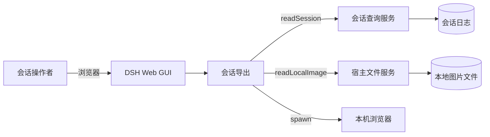
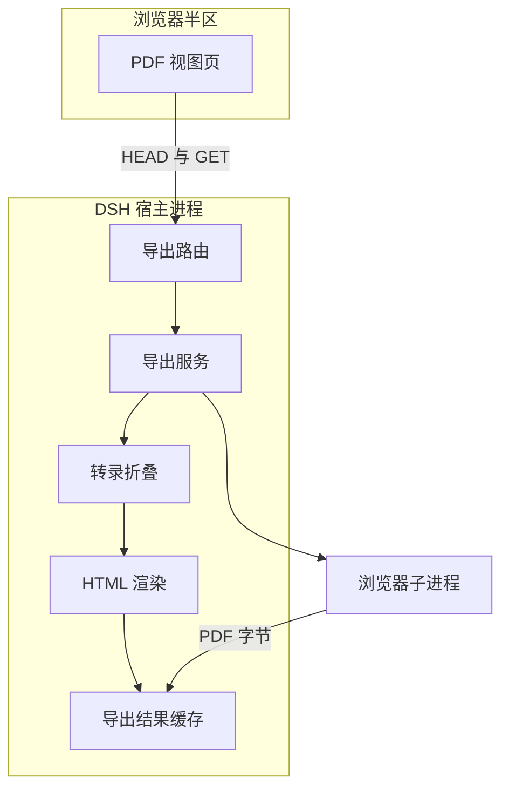
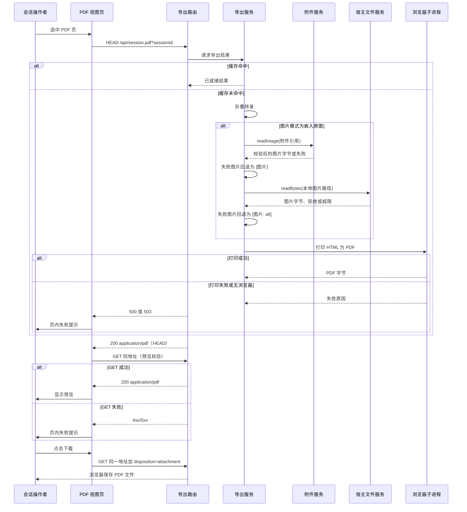
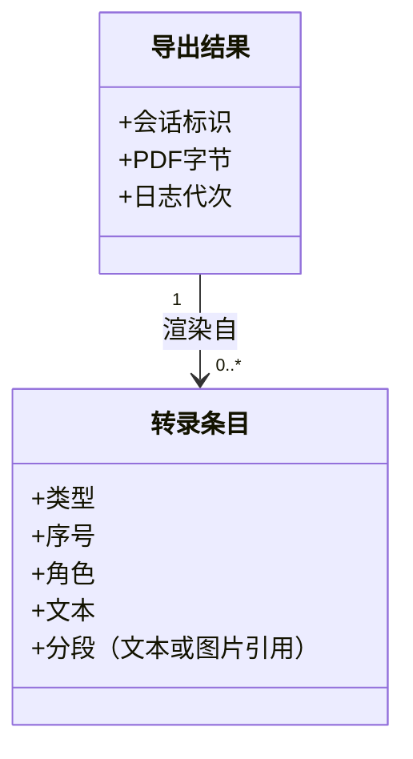
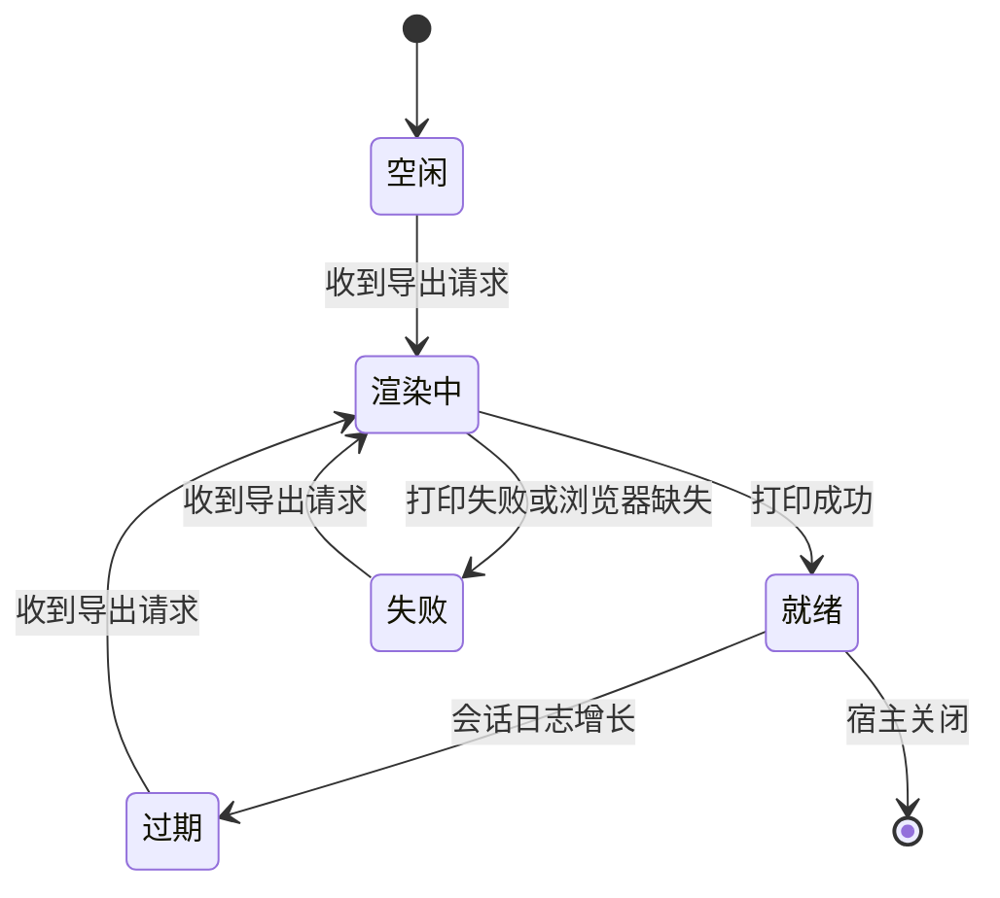
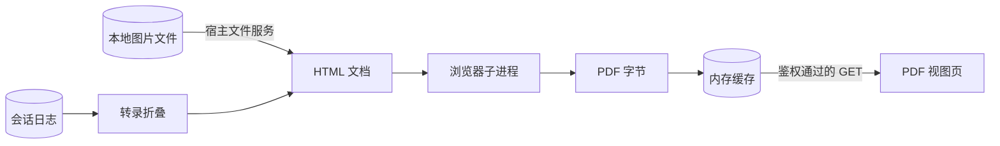

# SOLUTION — 会话导出为 PDF

## 架构视图清单

| 视图 | 适用性/理由 | 图表位置 |
|---|---|---|
| 系统上下文 | 适用：插件位于 DSH 宿主内，外部只有会话日志、会话查询服务、宿主文件服务与本机浏览器。 | 系统上下文图 |
| 一级静态分解 | 适用：宿主半区与浏览器半区通过一条精确路由相连，是全部实现的骨架。 | 一级静态分解图 |
| 内部组件分解 | 不适用：一级分解已把五个组件展开到可实现的粒度，再拆一层只是重复。 | — |
| 运行时交互 | 适用：首次选中、缓存命中、渲染失败、下载四条路径的行为不同，需要图固定。 | 运行时交互图 |
| 数据与领域模型 | 适用：转录条目是渲染器的唯一输入，其类型结构决定内容正确性。 | 数据与领域模型图 |
| 状态与生命周期 | 适用：导出结果在内存中经历就绪、过期与失败，缓存与复用规则依赖该状态机。 | 状态与生命周期图 |
| 数据流与信任边界 | 适用：会话内容从日志经宿主流向浏览器，下载接口跨越信任边界。 | 数据流与信任边界图 |
| 部署 | 不适用：插件随宿主进程加载，没有独立部署节点与制品。 | — |
| 分层与依赖 | 不适用：两个半区加一条路由已在一级分解中表达，依赖方向单一。 | — |
| 系统景观 | 不适用：只服务单个 DSH 宿主，不与其他产品集成。 | — |

## 方案细化清单

| 关注面 | 适用性/理由 | 方案落点 |
|---|---|---|
| 边界与对外契约 | 适用：路由的路径、参数、状态码与响应头是浏览器半区的唯一依赖。 | SOLUTION.md#产品契约 |
| 核心数据与不变量 | 适用：转录条目的顺序与排除规则决定导出内容是否正确。 | SOLUTION.md#核心数据与不变量 |
| 状态与生命周期 | 适用：缓存命中、过期与失败决定预览与下载是否一致。 | SOLUTION.md#导出状态与生命周期 |
| 运行时、并发与失败语义 | 适用：同一会话并发请求要合并，导出超时、渲染超时与浏览器缺失要可区分。 | SOLUTION.md#运行时与失败语义 |
| 外部集成 | 适用：会话查询服务、宿主文件服务与本机浏览器可执行文件是三个外部依赖。 | SOLUTION.md#外部集成 |
| 配置与可变点 | 适用：浏览器路径、渲染时限、导出总时限与并发上限是可变点。 | SOLUTION.md#配置与可变点 |
| 安全与信任边界 | 适用：下载接口承载会话内容，必须落在宿主的鉴权栅栏内。 | SOLUTION.md#安全与信任边界 |
| 部署、迁移与恢复 | 不适用：插件无独立部署、无持久化数据、无迁移与恢复流程。 | — |
| 兼容性与版本演进 | 适用：页签插槽与路由 API 属于宿主契约，版本边界要声明。 | SOLUTION.md#兼容性与版本演进 |
| 可观测性与运维 | 不适用：没有独立运维面，失败经由页内提示与宿主进程日志暴露。 | — |

## 实现就绪检查

| 条件 | 结论 | 证据或落点 |
|---|---|---|
| 边界与契约已明确 | 通过 | SOLUTION.md#产品契约 |
| 关键不变量已明确 | 通过 | SOLUTION.md#核心数据与不变量 |
| 重大方案选择已收敛 | 通过 | RATIONALE/C-001-chromium-print-html.md, RATIONALE/C-003-empty-state-host-hidden.md, RATIONALE/C-004-session-ownership-at-host-auth.md, RATIONALE/C-005-default-minimal-export.md, RATIONALE/C-006-image-modes.md, RATIONALE/C-007-mobile-pdf-open.md, RATIONALE/C-008-markdown-rendering.md, RATIONALE/C-010-markdown-local-images.md, RATIONALE/C-011-local-image-read-policy.md |
| 目标实现归属已明确 | 通过 | SOLUTION.md#子系统与模块 |
| 现状差距已有 task 承接 | 通过 | T-001～T-016 已交付既有需求（completed）；无未承接差距 |
| 可派生验证 | 通过 | SOLUTION.md#产品契约 |

## 静态架构

### 系统上下文图

会话日志是唯一的导出数据源。会话查询服务负责读取与校验日志，插件不直接触碰磁盘上的日志文件。宿主文件服务只在嵌入原图时读取消息正文引用的本地图片，读取权限与宿主进程一致（宿主沙箱只约束写入），最终符号链接被拒绝。本机浏览器只负责把 HTML 打印成 PDF，不读取任何会话数据。

### 一级静态分解图

路由只做参数校验与响应构造，不持有渲染逻辑。转录折叠与 HTML 渲染是纯函数，不接触宿主服务，可独立测试。

## 运行时视图

### 运行时交互图

预览与下载使用同一份导出结果；缓存命中时下载不会重新渲染，日志增长或样式变化会使缓存失效并重新渲染。选择变化会切换缓存键，仍由同一套缓存与单飞机制承接。
视图在 HEAD 200 后再发一次同源 GET 校验预览可交付，成功后挂载 iframe；GET 失败转页内错误并提供重试。该校验覆盖挂载前的可交付性；挂载后 iframe 自身的 GET 不再被观测，日志变化或缓存淘汰仍可能让查看器显示错误页。

## 数据视图

### 数据与领域模型图

转录条目的类型只有三种：用户消息、助手回复、工具调用。思考块在折叠阶段丢弃，不进入 PDF；工具调用仅在导出选择包含 `tools` 时进入条目列表。消息条目保留文本与图片分段，图片模式为嵌入时图片分段保存附件引用，渲染前再解析为内联图片。消息正文里的 Markdown 图片按地址另建内联图片索引，解析不到的地址保留 `[图片: alt]` 文字。

### 状态与生命周期图

导出结果只存在于宿主内存，不落盘。会话日志增长使结果过期，下一次请求重新渲染。

## 补充架构视图

### 数据流与信任边界图

信任边界在导出路由上。宿主浏览器鉴权与同源检查由 Connection 的 `/api` 桥完成，插件在边界内再校验会话标识。本地图片文件在边界内由宿主文件服务读取，字节只以 data URI 进入 HTML，不经过浏览器半区。

## 产品契约

导出路由是插件唯一的对外契约。

| 项 | 值 |
|---|---|
| 方法与路径 | `GET /api/session.pdf`、`HEAD /api/session.pdf` |
| 参数 `sessionId` | 必填，会话标识；只接受 ASCII 字母、数字与 `.`、`_`、`:`、`-`，长度不超过 200 |
| 参数 `disposition` | 可选，`inline` 或 `attachment`，缺省 `inline` |
| 参数 `include` | 可选，逗号分隔的 `tools`、`attachments`；`attachments` 只控制文件附件占位；缺省或空串表示不加入工具与文件，只保留消息文本与缺省图片占位；顺序归一，重复或未知值 `400` |
| 参数 `image` | 可选，`placeholder`、`embed` 或 `none`；缺省或空串为 `placeholder`；`embed` 同时嵌入上传图片与消息正文里的本地图片；未知值 `400` |
| 预览承载 | 桌面视口用同源 PDF iframe；视口宽度 ≤720px 时不渲染 iframe，改为在新标签页打开同一份 PDF，由系统查看器浏览全部页面 |
| 成功响应 | `200`，`Content-Type: application/pdf`，`Content-Disposition` 取 `disposition` 与带选择后缀的文件名 |
| 参数缺失或非法 | `400`，纯文本说明 |
| 会话不存在或日志不可读 | `404`，纯文本说明 |
| 子会话（`origin` 为 `subagent`，或 `delegationDepth > 0`） | `400`，纯文本说明；对应非目标 NG-6 的请求侧强制 |
| 折叠后无可导出的转录内容 | `204`，无正文，`Cache-Control: no-store`；不启动浏览器渲染 |
| 渲染失败 | `500`，纯文本说明 |
| 无可用浏览器或缺少中文字体 | `503`，纯文本说明 |
| 错误机器码 | 所有错误响应带 `x-dsh-export-error`，取值为 `request`、`session`、`subagent`、`font`、`browser`、`render`、`internal` 之一 |

- 文件名固定为 `dsh-session-<会话标识前 8 位>.pdf`；会话标识带 `session-` 公共前缀时先去掉前缀再取 8 位，否则不同会话会得到同一个文件名。选择 `tools` 时追加 `-tools`，选择文件附件时追加 `-attachments`，图片模式 `embed` 追加 `-images`，`none` 追加 `-no-images`；多个后缀按 `-tools`、`-attachments`、`-images`/`-no-images` 的顺序拼接，避免同会话的不同选择互相覆盖。
- `HEAD` 与 `GET` 的校验、状态码与响应头一致，只是不返回正文；浏览器半区用 `x-dsh-export-error` 把无正文的失败映射成具体中文原因。
- 同一会话同一 `include` 选择与图片模式的并发请求合并到一次渲染，所有请求拿到同一份字节；不同选择或不同图片模式的缓存互不复用。

## 核心数据与不变量

- 转录条目按 `readSession` 返回的事件顺序排列（日志序号升序），顺序不可重排。
- 折叠三类条目：用户消息、助手回复、工具调用；思考块在折叠阶段丢弃。
- 导出选择是内容组成：`tools` 加入工具调用，`attachments` 加入文件附件占位；图片由独立的图片模式控制，缺省 `placeholder`。
- 图片模式 `placeholder` 把图片块降为 `[图片]`，纯图片消息保留；`embed` 保留图片引用并在渲染前嵌入原图，读取失败回退 `[图片]`；`none` 省略图片块与纯图片消息。
- Markdown 图片在 `embed` 模式下按本地路径嵌入，其余模式与读取失败时呈现 `[图片: alt]`；`none` 只省略图片块，不删除 Markdown 图片的占位文字。
- 文件块只在 `attachments` 选中时产生 `[附件: 文件名]`；文件本体从不嵌入 PDF，纯文件消息未选文件附件时不进入条目列表。
- 附件图片只读取消息附件引用经 `ctx.attachments.readImage` 校验的字节，不按外部 URL 抓取。
- 本地图片经宿主文件服务 `ctx.fs` 解析路径并读取，读取权限与聊天界面显示本地图片一致（宿主沙箱只约束写入，两侧都用 `lstat` 拒绝最终符号链接）；只接受常见图片扩展名且字节嗅探为真图片，读取上限取 `ctx.attachments.imageLimits.maxImageBytes`。
- 嵌入图片统一缩放到版心内：宽度不超过消息气泡；Markdown 内联图最高 220mm，附件图片最高 120mm，均不越出页面边界。
- 用户与助手正文先按 Markdown 渲染成受控 HTML：块级标题/列表/引用/围栏代码/表格/分隔线，行内加粗/斜体/删除线/行内代码/链接与图片；原始 HTML 只按文本转义，链接只允许 http、https、mailto。
- Markdown 图片在嵌入模式下替换为内联 ``；占位、不导出与读取失败时显示 `[图片: alt]`，http、https 地址始终不抓取。
- 窄视口（≤720px）不渲染页内 PDF iframe；显示同源“打开完整 PDF”链接，在新标签页用系统查看器浏览全部页面。桌面视口保留页内原生 PDF 预览。两种入口共用同一缓存结果、文件名与选择。
- 用户消息只取 `source.kind` 为 `user` 的真人输入；运行上下文、技能目录、时间提示等内部注入不进入 PDF，否则导出会夹带整份 Agent 指令。旧格式日志没有 `source` 字段时按真人输入处理，避免历史会话导出为空。
- 折叠后没有任何条目时按“当前选择下无可导出内容”处理，以 `204` 结束。
- 工具调用渲染为单行，内容为工具名与参数摘要；未选择 `tools` 时不产生该行。
- 用户消息在版式中右对齐、助手回复左对齐，单条消息宽度不超过版心的 82%；文本在版心内换行，不越出页面边界。
- 用户与助手消息的角色标签分别配有内联人形与机器人图标，图标不依赖外部资源，随角色标签同页显示。
- 思考块在折叠阶段丢弃，不进入 PDF。
- 子会话不进入折叠、渲染与缓存，也不启动浏览器。
- 会话日志只读，导出不写回日志文件。
- PDF 不含页眉页脚与页码，页面内容只来自转录。
- 不使用 Chrome 默认页眉页脚，因为它会写入日期、标题与临时文件路径。
- 页面样式表（`src/page-style.css`）是数据文件：导出时按内容读取并注入 `<style>`，同一次导出的预览与下载共用同一份样式；样式版本进 PDF 缓存键，改样式后旧结果失效。
- 渲染管线由纯逻辑模块（选择、命名、Markdown、折叠、图片、HTML 渲染、导出编排）按源码内容哈希热加载：源码变化后下一次导出使用新模块并重建编排器，PDF 缓存随之清空；错误类型始终来自静态 `errors.mjs`，`instanceof` 映射不因热加载而失效。

## 导出状态与生命周期

- 导出结果按“会话标识 + `include` 选择 + 图片模式”缓存在宿主内存，条目记录日志长度与字节数。
- 日志长度变化即视为过期，下一次请求重新渲染；选择或图片模式变化会命中另一条缓存或重新渲染，不复用其它选择/模式的字节。
- 缓存同时受条数（32）与字节预算（128 MiB）约束，任一上限触发都按最久未使用淘汰。
- 图片读取失败导致内容降级的 PDF 不写入缓存，下一次请求重新读取；同键旧缓存被清除，避免降级结果长期滞留。
- 同一会话同一选择与图片模式在同一时刻只允许一个渲染任务，其余请求等待该结果。
- 宿主关闭即丢弃全部结果，不写盘、不恢复。

## 运行时与失败语义

- 单次导出总时限取 `exportTimeoutMs`；读日志、图片解析或打印任一步超时，请求以 `500`（错误机器码 `render`）结束，单飞表清理，不缓存半成品。浏览器子进程另有 `timeoutMs` 的打印时限。
- 浏览器可执行文件缺失时立即以 `503` 结束，不启动子进程。
- 宿主缺少可用的中文字体时立即以 `503` 结束，并说明缺少中文字体。
- 折叠结果为空（包括图片模式为 `none` 且只剩图片消息，或只选了 `tools` 但会话没有工具调用）时以 `204` 结束，不启动浏览器，也不写临时文件。
- 图片模式为 `embed` 时，单张图片读取失败、字节校验失败或格式不受支持均记录日志并回退占位；附件回退 `[图片]`，Markdown 图片回退 `[图片: alt]`，不因单图失败中断整份导出。
- 子会话标识在读取日志后、渲染前被拒绝，以 `400` 结束；不折叠、不打印、不缓存，也不启动浏览器。
- 子进程以非零码退出时取其标准错误的前若干行作为失败说明，写入宿主日志，响应只给简要原因。
- 临时 HTML 与 PDF 文件写在系统临时目录，用尽即删，异常路径同样删除。
- 并发渲染数受配置上限约束，超出时排队而非并行启动多个浏览器进程。
- 渲染管线按源码内容哈希即时生成并加载；生成或加载失败时沿用上一版管线并记日志，从未成功加载过才以 `500` 结束。
- 页面样式表不可读时以 `500`（错误机器码 `render`）结束并记录原因，不交付无样式 PDF。

## 外部集成

- 会话查询服务：经 `ctx.sessionQuery` 读取会话日志，会话不存在时抛 `SESSION_QUERY_SESSION_NOT_FOUND`。
- 附件服务：经 `ctx.attachments.readImage(ref)` 读取并校验本会话消息引用的图片字节；只接受日志中的附件引用，不按外部 URL 抓取。
- 宿主文件服务：经 `ctx.fs` 的 `lstat`、`resolve`、`readBytes` 读取消息正文引用的本地图片；服务缺失时本地图片退回占位，不阻止导出。
- 本机浏览器：配置路径优先；未配置时先探测平台标准安装位置（macOS 应用包、Windows `ProgramFiles`/`LocalAppData` 下的 Chrome、Edge、Chromium），再按 PATH 名称列表探测，启动无头模式打印 HTML。
- 本机字体：探测中文字体是否可用，缺失时拒绝导出而不是输出缺字 PDF。先执行 `fc-list :lang=zh`；未命中、不可用或返回空列表时继续扫描系统字体目录，覆盖 Linux、macOS 与 Windows 的常见字体文件名；探测结果缓存在宿主进程内。
- 宿主的连接服务：经 `ctx.connection.fetch.register` 注册精确路由，鉴权由该桥提供。

## 配置与可变点

| 字段 | 缺省 | 含义 |
|---|---|---|
| `browserPath` | 空 | 浏览器可执行文件路径；空表示先探平台标准安装位置，再按 PATH 探测 |
| `timeoutMs` | 30000 | 单次渲染的截止时间 |
| `exportTimeoutMs` | 120000 或 `timeoutMs` 中较大者 | 单次导出（读日志、图片解析与打印）的总时限；显式值不得小于 `timeoutMs` |
| `maxConcurrentRenders` | 2 | 同时运行的最大渲染数 |

- 以上字段只经 profile patch 注入；插件不导出 DSH `Config` schema，Plugin Manager 不展示这些字段，`normalizeConfig` 在装载期负责校验；显式 `exportTimeoutMs` 不得小于 `timeoutMs`，未显式配置时取 120000 与 `timeoutMs` 的较大者。
- 页面尺寸固定 A4，不提供配置，对应非目标 NG-4。
- 探测顺序固定为：配置路径 → 平台标准安装位置 → PATH 名称列表（`google-chrome`、`google-chrome-stable`、`chromium`、`chromium-browser`、`microsoft-edge`）。

## 安全与信任边界

- 路由挂在 `/api` 下，宿主对每个请求执行浏览器会话鉴权与 Host/Origin 检查。
- 插件在边界内校验 `sessionId` 非空且格式合法，参数非法返回 `400`；会话归属与访问控制由宿主的浏览器鉴权与 Host/Origin 栅栏承担，路由不判断页面当前可见会话（C-004）。
- 响应不设置 `Access-Control-Allow-Origin`，跨源读取不可用。
- 浏览器子进程只接收插件生成的 HTML，不接触凭据与用户环境变量。
- 错误响应只给简要原因，不回显日志内容或文件路径。
- 本地图片读取只发生在导出边界内：路径来自会话消息正文，经宿主文件服务解析并读取，读取权限等同宿主进程（沙箱只约束写入），最终符号链接被拒绝；只读、只接受图片扩展名与图片字节、受大小上限约束，不写回文件。

## 兼容性与版本演进

- 宿主下限为 `0.2.0-rc.2`，即当前安装版本；`conversation.view` 插槽与 `connection.fetch` 路由在该版本已存在。
- 插件注册的视图条目 id 固定为 `pdf`，不与其他视图冲突。
- 路由路径不做版本号，破坏性变更走新路径并保留旧路径一个版本。
- 热加载生成的临时模块写在系统临时目录的 0700 私有目录（`mkdtemp`，目录名带 PID 与随机后缀），文件名带内容哈希；插件卸载时删除该私有目录，首次加载时回收超过 24 小时且所属进程已不存在的旧目录；进程内保留已加载的各版本模块，规模随本进程存活期内的源码版本数增长。

## 需求追溯索引

| 需求 | 主责子系统 | 方案落点 | 实现位置 |
|---|---|---|---|
| R-01-001 | 会话导出 | SOLUTION.md#产品契约 | src/view.mjs, src/view-state.mjs |
| R-01-002 | 会话导出 | SOLUTION.md#运行时交互图 | src/view.mjs, src/view-state.mjs |
| R-01-003 | 会话导出 | SOLUTION.md#产品契约 | src/view.mjs, src/naming.mjs, src/route.mjs |
| R-01-004 | 会话导出 | SOLUTION.md#核心数据与不变量 | src/transcript.mjs |
| R-01-005 | 会话导出 | SOLUTION.md#核心数据与不变量 | src/render.mjs |
| R-01-006 | 会话导出 | SOLUTION.md#运行时与失败语义 | src/exporter.mjs, src/chrome.mjs, src/fonts.mjs, src/route.mjs |
| R-01-007 | 会话导出 | SOLUTION.md#核心数据与不变量 | src/transcript.mjs, src/exporter.mjs |
| R-01-008 | 会话导出 | SOLUTION.md#安全与信任边界 | src/route.mjs, src/host.mjs |
| R-01-009 | 会话导出 | SOLUTION.md#核心数据与不变量 | src/render.mjs |
| R-01-010 | 会话导出 | SOLUTION.md#核心数据与不变量 | src/render.mjs |
| R-01-011 | 会话导出 | SOLUTION.md#核心数据与不变量 | src/selection.mjs, src/transcript.mjs, src/exporter.mjs, src/route.mjs, src/naming.mjs, src/view.mjs, src/view-state.mjs |
| R-01-012 | 会话导出 | SOLUTION.md#核心数据与不变量 | src/selection.mjs, src/images.mjs, src/markdown.mjs, src/transcript.mjs, src/render.mjs, src/exporter.mjs, src/route.mjs, src/naming.mjs, src/host.mjs, src/view.mjs, src/view-state.mjs |
| R-01-013 | 会话导出 | SOLUTION.md#产品契约 | src/view.mjs, src/view-state.mjs |
| R-01-014 | 会话导出 | SOLUTION.md#核心数据与不变量 | src/markdown.mjs, src/html.mjs, src/render.mjs, src/images.mjs |

## 子系统与模块

### 会话导出
- 职责: 把一份会话按所选内容组成渲染成 PDF，并在会话页内提供预览与下载（承接 R-01-001～R-01-014）。
- 关键内部结构:
  - 宿主半区注册一条精确路由，承担参数校验、渲染编排、缓存与响应。
  - 浏览器半区注册一个 `conversation.view` 条目，承担预览、内容选择与下载交互；选择变化会中止旧请求的客户端等待并按新选择重取，服务端任务由导出总时限收口。
  - 转录折叠与 HTML 渲染是纯函数；图片解析经过附件服务与宿主文件服务，负责把附件引用和本地路径转成内联字节并对失败回退占位。
  - 宿主装配把 `ctx.fs` 包成本地图片读取函数注入导出编排器；该服务缺失时只影响 Markdown 本地图片嵌入，导出照常进行。
  - 浏览器进程按需启动，一次渲染一个进程，结束即回收。
  - 渲染管线由 `pipeline.mjs` 按内容哈希加载，页面样式由 `page-style.mjs` 按内容读取；这两处改动在导出时生效，不需要重启宿主（C-009）。
  - 宿主装配、路由与配置在启动时固定，改动它们仍需重启宿主。
- 代码位置: src/selection.mjs, src/images.mjs, src/html.mjs, src/markdown.mjs, src/transcript.mjs, src/render.mjs, src/exporter.mjs, src/naming.mjs, src/host.mjs, src/route.mjs, src/config.mjs, src/errors.mjs, src/chrome.mjs, src/fonts.mjs, src/process.mjs, src/pipeline.mjs, src/page-style.mjs, src/page-style.css, src/view.mjs, src/view-state.mjs, src/client.mjs, scripts/build-client.mjs
- 实现: 双端

## 横切约束

- 不引入运行时 npm 依赖，PDF 生成只借助本机浏览器可执行文件。
- 源码是不需编译的纯 ESM；浏览器半区由 `scripts/build-client.mjs` 拼装成宿主模块系统要求的 `window.__ModuleLoader__.load(...)` 工厂脚本。
- 宿主半区的渲染管线在首次导出时按源码内容即时生成自包含模块（临时目录、内容哈希作版本），运行期不需要构建步骤；浏览器半区仍走构建脚本。
- 视图条目使用固定标签 `PDF`，不注册其它插槽；视图文案为简体中文，不注册 Client locale 字典。
- 所有失败转成页内提示，不向宿主抛出未处理异常。
- 临时文件在成功、失败与超时三条路径上都回收；子进程由 `timeoutMs` 终止。当前没有服务端取消路径，客户端 abort 只停止等待；导出总时限只保证请求有界，已超时的渲染任务仍可能占用并发槽到 `timeoutMs`。

## 技术选型

- PDF 生成采用“HTML 加本机 Chromium 打印”，理由与被否方案见 RATIONALE/C-001-chromium-print-html.md。
- 预览采用浏览器原生 PDF 查看器，经同源路由直接加载 PDF，不引入 PDF.js；窄视口受内置查看器限制，改为在新标签页用系统查看器打开 PDF。
- 不使用模板引擎，HTML 由字符串拼接与转义函数产出。
- 渲染层热加载：按内容哈希重载模块，页面样式抽成 CSS 数据文件；不引入子进程渲染或打包器，被否方案与理由见 RATIONALE/C-009-hot-reload-render-pipeline.md。
- Markdown 由无依赖的安全子集转换（C-008），不引入 `marked` 等运行时依赖；原始 HTML、危险协议链接与外部 Markdown 图片都不进入渲染输出。
- Markdown 本地图片经宿主文件服务读取并内联为 data URI，不新增外部图片代理或缓存；选型与被否方案见 RATIONALE/C-010-markdown-local-images.md 与 RATIONALE/C-011-local-image-read-policy.md。
- 实测样本（2026-11-16，Chrome 156）：44 个回合块加表格与代码块输出 6 页 A4、241 KB；文本层可抽取全部中文；单次打印 1.45 秒、峰值内存 236 MB。
- 中文字体以 Type 3 形式嵌入，文本仍可选择与搜索；若换成 TTF 轮廓字体，Chrome 通常嵌入为 CID TrueType。
- 页脚不显示页码，理由与被否方案见 RATIONALE/C-002-no-page-numbers.md。
